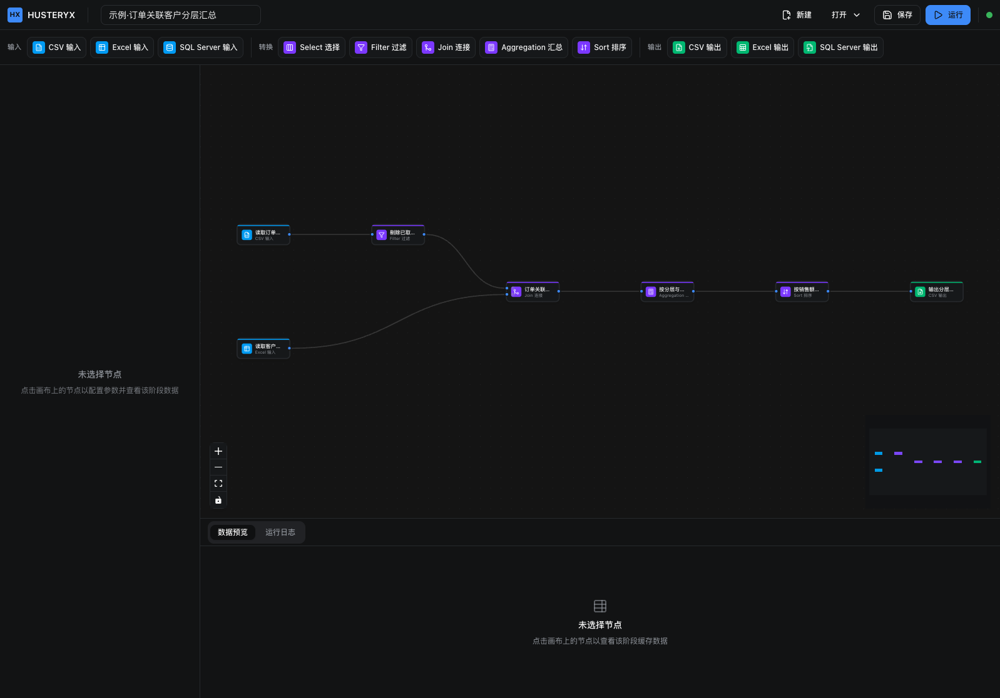
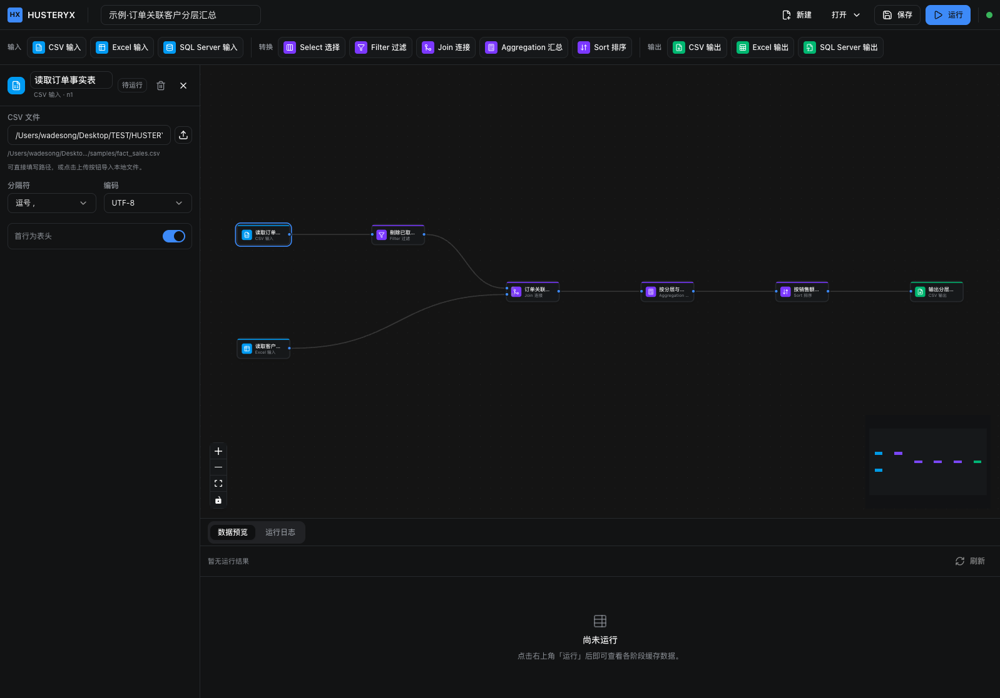
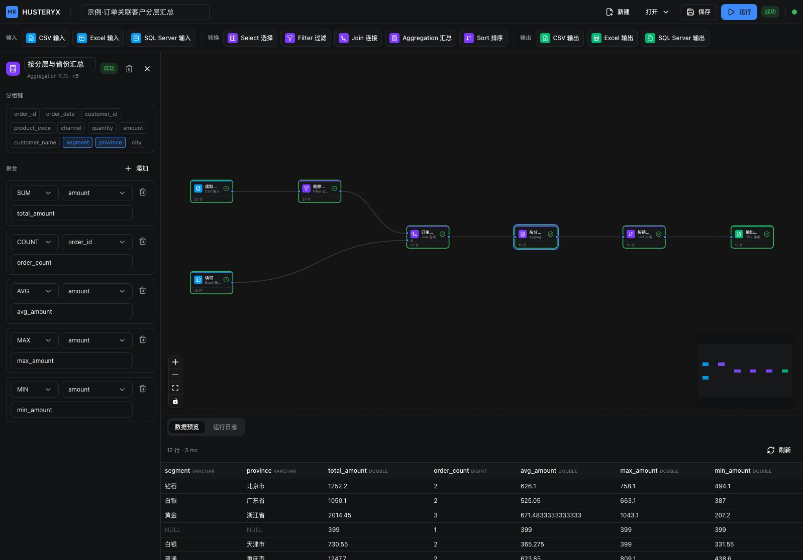

# HUSTERYX

单机桌面低代码 ETL 工具（简易版 Alteryx）。以拖拽 DAG 的方式构建数据处理工作流：从文件 / 数据库读取数据，经过转换后写出到文件或数据库，并可点击任意阶段查看该阶段的缓存数据。

> 完全遵循 Alteryx 的操作范式：**拖拽 DAG → 配置节点参数 → 运行工作流 → 点击阶段查看缓存数据**。

## 功能特性

**输入节点**

| 节点 | 说明 |
| --- | --- |
| CSV 输入 | 读取本地 CSV，可配置分隔符、表头、编码（utf-8 / gbk） |
| Excel 输入 | 读取 Excel 工作表，可选择 sheet |
| SQL Server 输入 | 执行 SQL 查询读取 SQL Server 数据 |

**转换节点**

| 节点 | 说明 |
| --- | --- |
| Select | 选择、重命名、重排列 |
| Filter | 按 SQL 布尔表达式过滤行 |
| Join | 按连接键合并两路数据（inner / left / right / full） |
| Aggregation | 分组聚合，支持 Sum / Count / Max / Min / Avg |
| Sort | 按多列排序（asc / desc，可指定 NULL 位置） |

**输出节点**

| 节点 | 说明 |
| --- | --- |
| CSV 输出 | 写出 CSV 文件 |
| Excel 输出 | 写出 Excel 工作表 |
| SQL Server 输出 | 写入 SQL Server 表（append / overwrite） |

其他能力：

- 画布支持拖拽建节点、连线、选中、删除，右下角鹰眼视图（MiniMap）总览工作流结构。
- 运行时按 DAG 拓扑顺序执行，节点实时着色显示状态（pending / running / success / error）。
- 通过 SSE 推送运行日志与节点结果，底部面板切换「数据预览 / 运行日志」。
- 工作流元数据持久化到 SQLite，可新建 / 保存 / 加载 / 删除。

## 技术栈

- **前端**：React 19 + TypeScript + Vite + Tailwind v4 + ShadCN 风格组件 + `@xyflow/react`（React Flow）+ Zustand
- **后端**：Fastify 5 + TypeScript（ESM），核心计算引擎基于 **DuckDB** + Apache Arrow
- **持久化**：SQLite（工作流元数据）、Parquet（中间缓存与 spill）
- **通信**：HTTP + SSE
- **桌面外壳**：Tauri v2

设计约束：单机流式优先，不做分布式；**不手写 join / spill 逻辑，全部交给 DuckDB**。

## 目录结构

```
HUSTERYX/
├── backend/                     # Fastify + DuckDB 计算引擎
│   └── src/
│       ├── config.ts            # 端口、数据目录、预览与内存等配置
│       ├── server.ts            # Fastify 实例与路由注册
│       ├── index.ts             # 服务入口
│       ├── db/sqlite.ts         # 工作流元数据持久化
│       ├── engine/              # duckdb / graph / executor / registry / runStore / ingest
│       ├── nodes/               # 各节点实现（输入 / 转换 / 输出）
│       ├── routes/              # workflows / runs / files / connections
│       └── util/                # sqlIdent / sse / values / io / mssql / format
├── frontend/                    # React + React Flow 前端
│   └── src/
│       ├── api/                 # HTTP client + SSE 客户端
│       ├── components/
│       │   ├── canvas/          # FlowCanvas / NodeCard / NodePalette / Toolbar
│       │   ├── panels/          # 各节点配置面板
│       │   ├── preview/         # 底部面板 / 数据预览 / 运行日志
│       │   └── ui/              # ShadCN 风格原子组件
│       ├── lib/                 # nodeMeta / graph / format / utils
│       ├── pages/Workbench.tsx  # 主工作台布局
│       ├── store/workflowStore.ts
│       └── types.ts             # 前后端共享类型契约
├── src-tauri/                   # Tauri v2 桌面外壳
├── samples/                     # 样例 CSV / Excel 与工作流 JSON
├── docs/                        # 实现计划等文档
├── INIT.md / TECH.md            # 需求与选型说明
└── pnpm-workspace.yaml          # pnpm workspace 配置
```

## 环境要求

- Node.js ≥ 20（建议 22 LTS）
- pnpm ≥ 9
- （可选）Rust 工具链 + Tauri 依赖，仅在构建桌面应用时需要

`better-sqlite3` 与 `@duckdb/node-api` 为原生模块，已在 `pnpm-workspace.yaml` 的 `onlyBuiltDependencies` 中声明。

## 快速开始

```bash
# 1. 安装依赖（在仓库根目录）
pnpm install

# 2. 同时启动后端与前端的开发模式
pnpm dev
```

启动后：

- 前端：http://localhost:5173
- 后端：http://127.0.0.1:8787 （健康检查 `GET /api/health`）

也可分别启动：

```bash
pnpm dev:backend    # 仅后端（tsx watch）
pnpm dev:frontend   # 仅前端（Vite）
```

## 界面预览

启动后即可看到完整的工作台布局：顶部为单行分组的节点工具条与操作按钮（新建 / 打开 / 保存 / 运行），左侧为选中节点的参数配置面板，中间是拖拽式 DAG 画布（右下角为鹰眼总览），底部在「数据预览 / 运行日志」之间切换。下图为一个已编排好的示例工作流：



选中任意节点，左侧面板即展开其参数配置。下图以「CSV 输入」为例，可选择数据文件、分隔符、编码与表头设置：



点击「运行」后按 DAG 拓扑顺序依次执行，节点实时着色并显示行数；点击任意阶段即可在底部查看该阶段的缓存数据（下图选中「按分层与省份汇总」节点）：



## 常用脚本

在仓库根目录：

| 命令 | 说明 |
| --- | --- |
| `pnpm dev` | 并发启动后端 + 前端 |
| `pnpm dev:backend` | 仅启动后端（tsx watch） |
| `pnpm dev:frontend` | 仅启动前端（Vite） |
| `pnpm build` | 构建后端（tsc）与前端（vite build） |
| `pnpm desktop` | 以 Tauri 桌面应用方式运行（`tauri dev`） |
| `pnpm desktop:build` | 打包桌面应用（`tauri build`） |

前端目录内另有 `pnpm typecheck`（`tsc --noEmit`）。

## 环境变量

后端（前缀 `HUSTERYX_`）：

| 变量 | 默认值 | 说明 |
| --- | --- | --- |
| `HUSTERYX_HOST` | `127.0.0.1` | 监听地址 |
| `HUSTERYX_PORT` | `8787` | 监听端口 |
| `HUSTERYX_DATA_DIR` | `~/.husteryx` | 运行期数据目录 |
| `HUSTERYX_MEMORY_LIMIT` | `2GB` | DuckDB 内存上限，超出自动 spill |
| `HUSTERYX_LOG_LEVEL` | `info` | 日志级别 |

前端：

| 变量 | 默认值 | 说明 |
| --- | --- | --- |
| `VITE_API_BASE` | `http://127.0.0.1:8787` | 后端基地址 |

## API 一览

| 方法 | 路径 | 说明 |
| --- | --- | --- |
| GET | `/api/health` | 健康检查 |
| GET / POST | `/api/workflows` | 列出 / 新建工作流 |
| GET / PUT / DELETE | `/api/workflows/:id` | 读取 / 更新 / 删除工作流 |
| POST | `/api/runs` | 提交工作流运行，返回 `{ runId }` |
| GET | `/api/runs/:runId` | 查询运行状态与各节点结果 |
| GET | `/api/runs/:runId/events` | SSE 订阅运行日志与节点结果 |
| GET | `/api/runs/:runId/preview/:nodeId?limit=` | 预览某阶段缓存数据 |
| POST | `/api/files/upload` | 上传文件（multipart），返回落盘路径 |
| GET | `/api/files/sheets?path=` | 列出 Excel 工作表 |
| POST | `/api/connections/sqlserver/test` | 测试 SQL Server 连接 |
| POST | `/api/connections/sqlserver/columns` | 探测表 / 查询的列信息 |

## 数据存储

运行期数据默认位于 `~/.husteryx/`（可用 `HUSTERYX_DATA_DIR` 覆盖）：

```
~/.husteryx/
├── metadata.sqlite   # 工作流元数据
├── spill/            # DuckDB spill 的 Parquet
├── uploads/          # 上传的输入文件
└── outputs/          # 输出节点产物
```

每次运行使用独立的 DuckDB `:memory:` 实例，每个节点执行后物化为表 `n_<nodeId>`，供下游节点引用与阶段预览；运行上下文保留 30 分钟后淘汰。

## 样例数据

`samples/` 目录提供开箱即用的样例：`orders.csv`、`fact_sales.csv/xlsx`、`dim_customer.csv/xlsx`，以及示例工作流 `workflow_join_aggregation.json`。可在此基础上直接拖拽验证 Join + Aggregation 等节点。

## 更多文档

- [INIT.md](./INIT.md)：项目需求与第一阶段范围
- [TECH.md](./TECH.md)：技术选型说明
- [docs/superpowers/plans/2026-10-12-husteryx-phase1.md](./docs/superpowers/plans/2026-10-12-husteryx-phase1.md)：第一阶段实现计划与前后端接口契约
